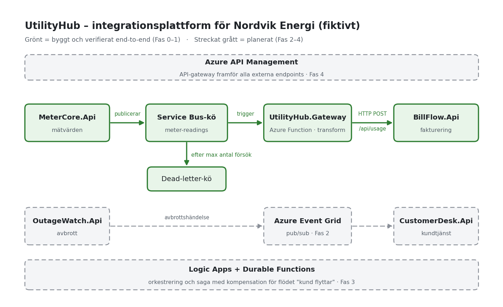
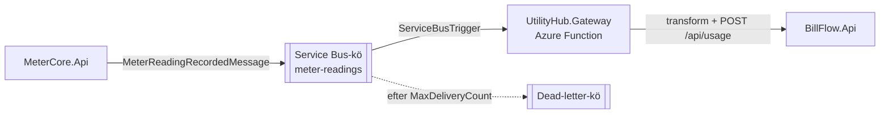

# UtilityHub

En simulerad integrationsplattform för ett fiktivt energibolag, **Nordvik Energi**, byggd för att visa hur legacy-integrationer moderniseras i Azure: garanterad meddelandeleverans, transform-and-forward, pub/sub, orkestrering kontra koreografi, saga-mönster och API-gateway.

Portfolioprojekt av **Peter Larsson**. Idén kommer från arbete med att migrera BizTalk-integrationer till Azure. Ingen riktig kunddata används – alla källsystem seedas med syntetisk data via [Bogus](https://github.com/bchavez/Bogus).



## Systemlandskap (simulerat)

Varje källsystem är ett eget mini-API i en egen container, som beter sig som ett fristående system.

| System | Roll | Motsvarar i verkligheten | Port |
| --- | --- | --- | --- |
| `MeterCore.Api` | Mätvärdesinsamling | Mätdatasystem | 5101 |
| `BillFlow.Api` | Fakturering och kundfordringar | Ekonomisystem | 5102 |
| `OutageWatch.Api` | Avbrottshantering | Drift-/SCADA-liknande källa | 5103 |
| `CustomerDesk.Api` | Kundtjänst | CRM | 5104 |

## Flödet som fungerar i dag (Fas 1)



1. `MeterCore.Api` publicerar ett meddelande på kön `meter-readings` när ett nytt mätvärde registreras.
2. Funktionen `ForwardMeterReadingToBilling` (isolated worker) triggas av kön, transformerar meddelandet till BillFlows format och skickar det vidare.
3. Om BillFlow är nere kastas ett undantag, meddelandet läggs tillbaka i kön och försöks igen – och hamnar till slut i dead-letter-kön. Leveransgarantin kommer från Service Bus, inte från egen retry-kod.

Kedjan är verifierad end-to-end: ett mätvärde postat mot MeterCore syns i BillFlow inom någon sekund.

## Integrationsmönster

| Mönster | Var | Status |
| --- | --- | --- |
| Garanterad leverans | Service Bus-kön `meter-readings` | ✅ Klart |
| Transform-and-forward | MeterCore → Gateway → BillFlow | ✅ Klart |
| Pub/sub och koreografi | Event Grid för avbrottshändelser (OutageWatch → CustomerDesk) | ⏭️ Nästa steg |
| Orkestrering | Logic Apps för flödet "kund flyttar" | 🗓️ Planerat |
| Saga och kompensation | Durable Functions för flerstegsprocesser | 🗓️ Planerat |
| API-gateway | Azure API Management framför externa endpoints | 🗓️ Planerat |

## Teknik

.NET 8 · ASP.NET Core minimal API · Azure Functions (isolated worker) · Azure Service Bus (officiell emulator lokalt) · Docker Compose · Bogus · Bicep · Azure DevOps Pipelines · planerat: Event Grid, Logic Apps, Durable Functions, API Management, Azure Container Apps, Application Insights

## Köra lokalt

**Krav:** Docker Desktop, [Azure Functions Core Tools](https://learn.microsoft.com/azure/azure-functions/functions-run-local) och Azurite (`npm install -g azurite`).

```bash
# 1. De fyra mini-API:erna + Service Bus-emulatorn
docker compose up --build

# 2. Azurite, i en egen terminal (lagring för Functions-hosten)
azurite --silent --location .azurite

# 3. Gateway-funktionen, i en tredje terminal
cd src/UtilityHub.Gateway
cp local.settings.json.example local.settings.json
func start
```

Testa hela kedjan:

```bash
curl -X POST http://localhost:5101/api/meterreadings \
  -H "Content-Type: application/json" \
  -d '{"meterId":"MTR-00001","customerId":"CUST-00001","consumptionKwh":4.2}'

# någon sekund senare:
curl http://localhost:5102/api/usage
```

Swagger UI finns på `/swagger` för varje API.

> **Nätverksdetalj:** Gateway-funktionen körs på värddatorn, utanför Docker-nätverket, så dess `ServiceBusConnection` pekar på `sb://localhost`. `MeterCore.Api` körs i en container och använder `sb://servicebus-emulator` via Compose-nätverkets DNS.

## Repo-struktur

```
UtilityHub/
├── src/
│   ├── MeterCore.Api/          mini-API, egen container
│   ├── BillFlow.Api/           mini-API, egen container
│   ├── OutageWatch.Api/        mini-API, egen container
│   ├── CustomerDesk.Api/       mini-API, egen container
│   ├── UtilityHub.Gateway/     Azure Function: Service Bus → transform → BillFlow
│   └── UtilityHub.DataSeeder/  platshållare för databas-seedning
├── infra/                      Bicep + Service Bus-emulatorns konfiguration
├── docs/                       systemdokumentation och bilder
├── docker-compose.yml
└── azure-pipelines.yml
```

## Roadmap

- [x] **Fas 0** – fyra containeriserade mini-API:er med syntetisk data, mono-repo
- [x] **Fas 1** – transform-and-forward via Service Bus och Azure Functions
- [ ] **Fas 2** – pub/sub och koreografi med Event Grid
- [ ] **Fas 3** – orkestrering och saga: Logic Apps + Durable Functions för "kund flyttar"
- [ ] **Fas 4** – API Management, Azure Container Registry och drift i Azure Container Apps

Fullständig beskrivning och ändringslogg finns i [`docs/UtilityHub-Systemdokumentation.docx`](docs/).
